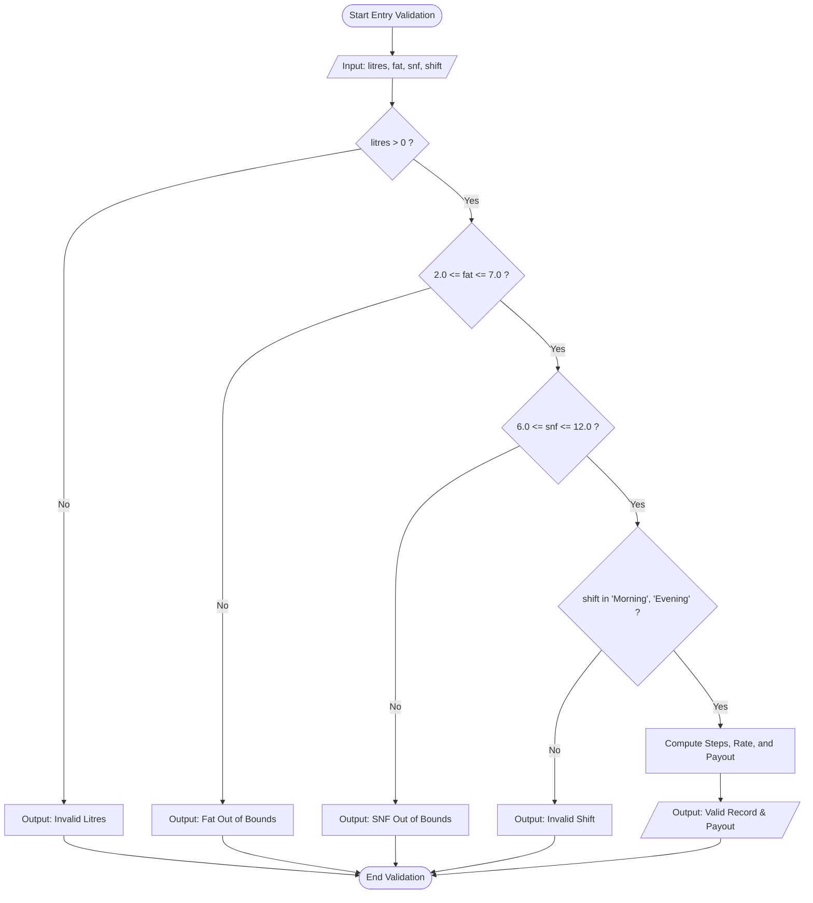

# TASK 08: Algorithmic Problem Solving & Pseudocode Specification

## 1. Algorithmic Problem-Solving Steps
1. **Understand**: Formulate inputs (farmer entries), outputs (payouts, ten-day sum), constraints (fat 2.0-7.0%, SNF 6.0-12.0%, litres > 0), and rate rules.
2. **Plan**: Design data validation, step-based rate calculation, and running aggregation algorithm.
3. **Write**: Express logic in standardized pseudocode following SIMATS Engineering conventions before coding.
4. **Test**: Dry-run with manual hand trace tables across boundary conditions.

---

## 2. Standardized Pseudocode

### ALGORITHM CalculateTenDayPayment
```text
START
    SET BASE_RATE TO 30.00
    SET FAT_STEP_VAL TO 0.40
    SET SNF_STEP_VAL TO 0.30
    SET ten_day_total TO 0.00
    SET valid_entries_count TO 0

    INPUT num_entries
    FOR each entry FROM 1 TO num_entries DO
        INPUT farmer_id, litres, fat, snf, shift

        // Validate Entry
        IF litres <= 0 THEN
            OUTPUT "Error: Litres must be positive for " + farmer_id
        ELSE IF fat < 2.0 OR fat > 7.0 THEN
            OUTPUT "Error: Fat out of bounds [2.0, 7.0] for " + farmer_id
        ELSE IF snf < 6.0 OR snf > 12.0 THEN
            OUTPUT "Error: SNF out of bounds [6.0, 12.0] for " + farmer_id
        ELSE
            // Computation
            SET fat_diff TO fat - 3.5
            SET fat_steps TO ROUND(fat_diff / 0.1)
            SET snf_diff TO snf - 8.5
            SET snf_steps TO ROUND(snf_diff / 0.1)

            SET rate TO BASE_RATE + (fat_steps * FAT_STEP_VAL) + (snf_steps * SNF_STEP_VAL)
            SET payout TO ROUND(litres * rate, 2)
            SET ten_day_total TO ten_day_total + payout
            SET valid_entries_count TO valid_entries_count + 1

            OUTPUT farmer_id + " Rate: Rs " + rate + " Payout: Rs " + payout
        ENDIF
    ENDFOR

    OUTPUT "Ten Day Total Payable: Rs " + ten_day_total
    OUTPUT "Valid Records Processed: " + valid_entries_count
END
```

---

## 3. Flowchart for Validating One Entry



---

## 4. Hand Trace for Three Sample Entries

| Step | Farmer ID | Litres | Fat % | SNF % | Validation | Fat Steps (`round((F-3.5)/0.1)`) | SNF Steps (`round((S-8.5)/0.1)`) | Rate / L (Rs) | Payout (Rs) | Running Total (Rs) |
|---|---|---|---|---|---|---|---|---|---|---|
| Init | - | - | - | - | - | - | - | - | - | **0.00** |
| 1 | F101 | 10.0 | 3.5 | 8.5 | Valid | (0.0)/0.1 = 0 | (0.0)/0.1 = 0 | 30.00 + 0 + 0 = **30.00** | 10.0 * 30.00 = **300.00** | **300.00** |
| 2 | F102 | 8.5 | 4.2 | 8.7 | Valid | (0.7)/0.1 = 7 | (0.2)/0.1 = 2 | 30.00 + 7(0.40) + 2(0.30) = **33.40** | 8.5 * 33.40 = **283.90** | **583.90** |
| 3 | F103 | 12.0 | 3.1 | 8.3 | Valid | (-0.4)/0.1 = -4 | (-0.2)/0.1 = -2 | 30.00 - 4(0.40) - 2(0.30) = **27.80** | 12.0 * 27.80 = **333.60** | **917.50** |

---

## 5. Alternative Concept & Complexity Analysis
- **Running Total (O(1) Space)**: Processes each record on arrival, updates `total += payout`. Ideal for stream processing.
- **List Accumulation (O(n) Space)**: Stores all records in memory. Necessary if audit trails, per-shift itemised receipts, or sorting are required.
- **Time Complexity**: O(n) for both approaches.
