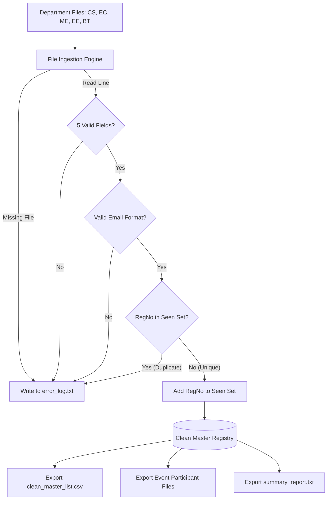

# ASSIGNMENT 4 - TASK 06: DESIGN CHALLENGE
## College Cultural Fest Registration Desk: Enterprise Package Specification

---

## Stage 1: Interpret the Problem (2 Marks)
1. **Inputs**: Five department registration text files (`CS.txt`, `EC.txt`, `ME.txt`, `EE.txt`, `BT.txt`).
   - Line format: `register_no,name,department,email,events`
   - Delimiters: Comma `,` for fields; Semicolon `;` for multi-event choices (e.g. `Coding;Quiz;Hackathon`).
2. **Failure Conditions Anticipated**:
   - Duplicate registrations (same student registering multiple times in same or different departments).
   - Invalid email addresses (missing `@`, missing domain dot, invalid characters).
   - Damaged records (fewer than 5 fields, empty values).
   - Missing department files (e.g. `BT.txt` not submitted yet by department rep).
3. **Outputs Required**:
   - `clean_master_list.csv`: Unique valid registrations (`RegisterNo,Name,Department,Email,EventsCount,EventsList`).
   - `event_<EventName>.txt`: Participant list for each event sorted by name.
   - `summary_report.txt`: Total registrations received, duplicates eliminated, invalid emails rejected, participant counts per event.
   - `error_log.txt`: Timestamped audit trail of all rejected lines and missing files.
4. **Resilience Requirement**: Zero program crashes (`exit code 0` guaranteed under all adversarial conditions).

---

## Stage 2: Processing Flow Diagram (2 Marks)



---

## Stage 3: Critical Design Decisions (2 Marks)
1. **Duplicate Detection**:
   - Maintained using a Python `set` of registered register numbers (`seen_reg_nos`).
   - Checking membership `reg_no in seen_reg_nos` is amortized $O(1)$ time, yielding overall $O(n)$ deduplication compared to $O(n^2)$ list searching.
2. **Email Validation via String Methods (No Regex)**:
   - Check `@` is present and appears exactly once (`email.count('@') == 1`).
   - Ensure local part and domain part exist (`user, domain = email.split('@')`).
   - Ensure domain contains at least one dot (`'.' in domain`) with valid characters.
3. **Exception Handling Architecture**:
   - `FileNotFoundError`: Caught per department file loop; logged without aborting remaining files.
   - `UnicodeDecodeError`: Caught with fallback encoding; logged if file is unreadable.
   - Record validation errors: Caught line-by-line; written to `error_log.txt`.

---

## Stage 4: Package Architecture & Pseudocode (4 Marks)

```
fest_registration/
├── __init__.py
├── validator.py    # Field splitting, email validation, duplicate verification
├── processor.py    # Multi-file reading, error trapping, data accumulation
└── reporter.py     # Master CSV, event files, and summary generation
```

### SIMATS-Standard Pseudocode:
```text
ALGORITHM ProcessFestRegistrations(department_files_list, output_directory)
START
    SET master_registry TO empty list
    SET seen_reg_nos TO empty set
    SET event_participants TO empty dictionary
    SET error_log TO output_directory + "/error_log.txt"

    FOR each file_path IN department_files_list DO
        TRY
            OPEN file_path AS f DO
                FOR each raw_line WITH line_number IN f DO
                    SET line TO TRIM(raw_line)
                    IF line IS EMPTY THEN CONTINUE ENDIF

                    SET is_valid, record_or_err TO VALIDATE_LINE(line)
                    IF NOT is_valid THEN
                        LOG_ERROR(error_log, file_path, line_number, record_or_err)
                        CONTINUE
                    ENDIF

                    IF record_or_err.reg_no IN seen_reg_nos THEN
                        LOG_ERROR(error_log, file_path, line_number, "Duplicate Registration: " + record_or_err.reg_no)
                        CONTINUE
                    ENDIF

                    ADD record_or_err.reg_no TO seen_reg_nos
                    ADD record_or_err TO master_registry

                    FOR each ev IN record_or_err.events DO
                        ADD record_or_err TO event_participants[ev]
                    ENDFOR
                ENDFOR
            CLOSE f
        CATCH FileNotFoundError THEN
            LOG_ERROR(error_log, file_path, 0, "Department file not found")
        ENDTRY
    ENDFOR

    WRITE_MASTER_CSV(master_registry, output_directory + "/clean_master_list.csv")
    WRITE_EVENT_FILES(event_participants, output_directory)
    WRITE_SUMMARY_REPORT(master_registry, event_participants, output_directory + "/summary_report.txt")
END
```
